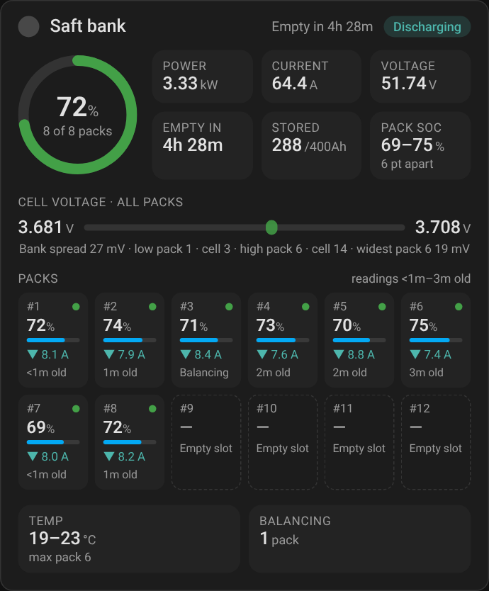
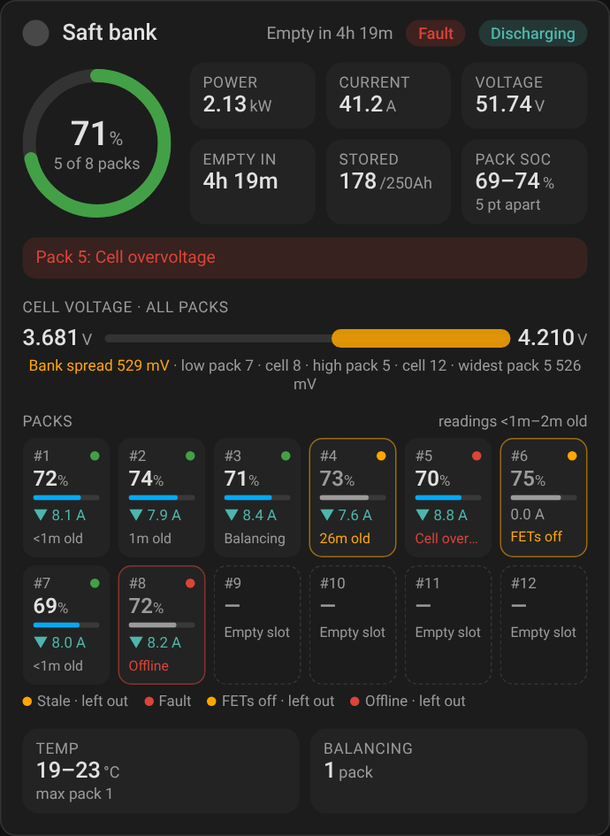

# Saft packs overview card

A Home Assistant Lovelace card for a battery bank made of many packs in parallel, each with its own BMS. It was built for a bank of Saft packs with JBD BMSs, which ESPHome reads over BLE ([syssi/esphome-jbd-bms](https://github.com/syssi/esphome-jbd-bms)). Any BMS whose sensors follow the same naming works too.

The bank totals use only the packs that are **operational**, meaning they reported recently and their FETs are closed. Every pack also gets its own tile, so you can see at a glance which packs are counted, which are left out, and why.

| Normal | With faults |
|------|-------|
|  |  |

The card's styling matches [krogo energy cards](https://github.com/krogo/HACS_Solark_Batrium_Emporia_Flow), so the two sit together on one dashboard.

## Install

**HACS:** HACS → ⋮ → Custom repositories → add `https://github.com/krogo/Saft_packs_overview_card` with type **Dashboard**. Install it, then hard-refresh your browser.

**Manual:** copy `saft-packs-card.js` to `/config/www/`. Add `/local/saft-packs-card.js?v=1` as a JavaScript module resource (Settings → Dashboards → ⋮ → Resources), then hard-refresh. Bump `?v=` after every update.

To add the card: Edit dashboard → Add card → search **saft**. On Home Assistant 2026.6 and later, the card is also suggested when you pick any `saft_<n>_…` sensor.

## Configuration

```yaml
type: custom:saft-packs-card
name: Saft bank
count: 12             # packs 1..12; packs with no sensors show as "Empty slot"
match: "saft_{n}_"    # part of the entity id before each value; {n} = pack number
capacity_ah: 50       # per pack; only needed if the BMS doesn't report nominal_capacity
stale_after: 10       # minutes without a new reading before a pack is left out
cell_range: [3.0, 4.2]
spread_warn: 0.05     # V; bank cell spread shown in amber above this
columns: 6            # pack grid columns (default: half the pack count)
names: { 1: "A1" }    # optional tile labels
entities:             # optional per-pack overrides when a sensor is named differently
  3: { soc: sensor.some_other_soc }
```

Every option except `type` can also be set in the visual editor.

### How the packs' sensors are found

For each pack `n`, the card looks for an entity whose id **ends** in `saft_<n>_` plus one of these keys. The id may also end with a `_2`-style suffix that Home Assistant adds to duplicates.

| Value | Key (ESPHome sensor name `Saft N …`) |
|---|---|
| Pack voltage, current, power, SOC | `total_voltage`, `current`, `power`, `soc` |
| Cells | `min_cell_v`, `max_cell_v`, `delta_cell_v`, `avg_cell_v`, `min_cell` (#), `max_cell` (#) |
| Temperatures | `temp_1`, `temp_2` |
| Status (binary sensors) | `online`, `charging`, `discharging`, `balancing` |
| Errors (text) | `errors` |
| Optional | `nominal_capacity`, `capacity_remaining`, `charging_cycles` |

The part before `saft_<n>_` is ignored. That part is usually the ESPHome device name, such as `sensor.saft_bank_a_saft_3_soc`, so a pack can move from one ESP to another without changing the card.

### What "operational" means

| Tile | Meaning | In bank totals? |
|---|---|---|
| green dot | reporting, FETs closed | yes |
| **Fault** (red) | BMS reports an error but its FETs are still closed | yes; the error is also shown in a banner |
| **FETs off** (amber) | charge and discharge FETs both open, so the pack is off the bus | no |
| **Stale** (amber) | no new reading for `stale_after` minutes | no |
| **Offline** (red) | the BMS `online` sensor is off, or the sensors are unavailable | no |
| Empty slot | the pack has no sensors (not installed, or its entities are disabled) | no |

The packs are in parallel, so the bank totals are calculated like this:

- Power and current are the sums over the operational packs.
- Voltage is the mean of the packs' bus readings. A ± value appears when the packs disagree by 50 mV or more.
- SOC is weighted by capacity when every pack's capacity is known, otherwise it is a plain average.
- Stored Ah is the sum of `capacity_remaining`, or SOC × capacity when that sensor is missing.
- Time to full or empty is the remaining (or missing) Ah divided by the bank current.
- The cell bar shows the lowest and highest cell in the whole bank and which pack and cell each one is in.

### Notes for the ESPHome rotation setup

- **Staleness is the only reliable "gone" signal.** The JBD component only counts unanswered polls while a pack is connected. If a pack never connects, it is never polled, so its sensors keep their last values and `online` stays on. The card therefore judges each pack by how recently it reported. The report time is the newest `last_updated` among its voltage, current, power, cell and SOC sensors, and these change on almost every reading. Set `stale_after` comfortably above one full sweep of an ESP, which is about 2.5–5 minutes for six packs.
- **Readings are not simultaneous.** Each ESP visits its packs one at a time, so the bank totals combine readings up to a few minutes apart. That's fine for a slow-changing overview, but it isn't a substitute for the inverter's or a shunt's live bank current. The card shows how old the readings are above the pack grid.
- **Packs 9–12:** `disabled_by_default` only applies the first time Home Assistant sees an entity. When you set `off_9: "false"` and reflash, those entities **stay disabled** in Home Assistant. Enable them on the ESPHome device page (Settings → Devices → Saft Bank B → entities). Until you do, the card shows them as Empty slot.
- To get true weighted SOC, stored Ah and time remaining, add `nominal_capacity`, `capacity_remaining` and `charging_cycles` to each pack's `jbd_bms_ble` sensor block. If you don't, set `capacity_ah`.

## Tests

`tests/make_states.py` writes mock states for 12 packs: 8 normal, plus a set with stale, FETs-off, offline and fault packs. `tests/shot.py` renders them in headless Chrome and prints the totals so they can be checked by hand.
